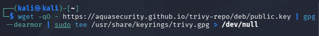
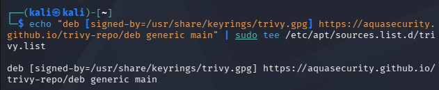
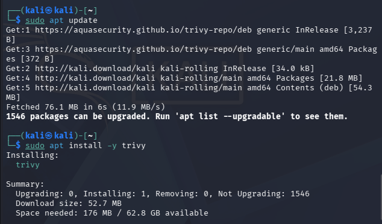
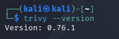
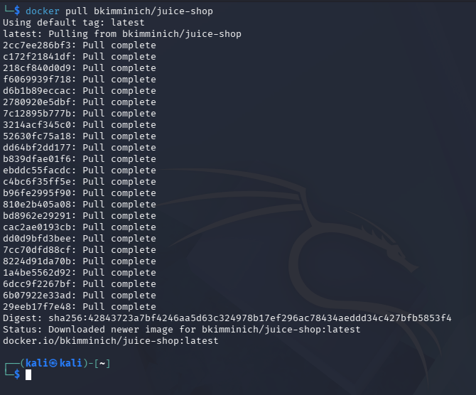

# Instalación y laboratorio

Entorno: Kali Linux en una VM, Trivy 0.76.1 y Docker.

## Instalar Trivy

Lo instalé desde el repositorio oficial:

```bash
sudo apt update
sudo apt install -y wget gnupg apt-transport-https
wget -qO - https://aquasecurity.github.io/trivy-repo/deb/public.key | gpg --dearmor | sudo tee /usr/share/keyrings/trivy.gpg > /dev/null
echo "deb [signed-by=/usr/share/keyrings/trivy.gpg] https://aquasecurity.github.io/trivy-repo/deb generic main" | sudo tee /etc/apt/sources.list.d/trivy.list
sudo apt update
sudo apt install -y trivy
trivy --version
```






Primero probé `sudo apt install aquasec/trivy` y dio *Unable to locate package*: `aquasec/trivy` es el nombre de la imagen de Docker, no de un paquete de apt.

Si no quieres instalar nada también vale `docker run --rm aquasec/trivy --version`.

## Docker y jq

```bash
sudo apt install -y docker.io jq
sudo systemctl enable --now docker
sudo usermod -aG docker $USER && newgrp docker
```

## Objetivos de prueba

```bash
docker pull bkimminich/juice-shop
git clone https://github.com/OWASP/NodeGoat.git
mkdir -p iac && cp examples/iac/* iac/
```



La primera vez que se ejecuta, Trivy descarga la base de datos de vulnerabilidades (unos 130 MB). Después la reutiliza.
