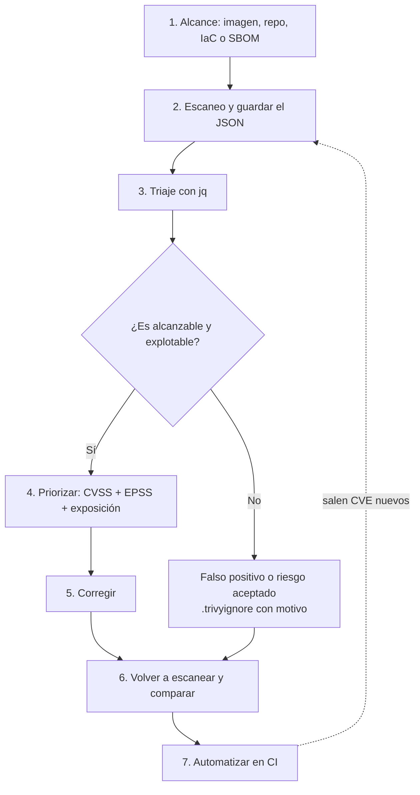

# Flujo de trabajo

Así sería un análisis completo con Trivy. Escanear es solo el primer paso, el trabajo real es decidir qué hacer con los resultados.

## Los pasos con el caso de Juice Shop

1. **Alcance**: la imagen `bkimminich/juice-shop` ([captura](../images/05-docker-pull-juice-shop.png)).
2. **Escaneo**: `trivy image -q --severity HIGH,CRITICAL --format json -o all.json bkimminich/juice-shop` ([captura](../images/06-resumen-severidad-all-vs-fixed.png)).
3. **Triaje**: con `jq` saco el recuento por severidad, los paquetes afectados y los secretos ([captura](../images/08-cves-criticos-jq.png)).
4. **Priorizar**: miro el CVE en NVD y su EPSS ([NVD](../images/17-nvd-cve-2019-10744.png), [EPSS](../images/18-epss-cve-2019-10744.png)).
5. **Corregir**: actualizar las dependencias que tienen versión corregida.
6. **Reescaneo**: repetir el mismo comando y comparar los totales.
7. **Automatizar**: [workflow de GitHub Actions](../examples/ci/.github/workflows/trivy.yml).

## Cosas que decide el analista, no la herramienta

- Qué severidad cortar. Normalmente `HIGH,CRITICAL`, pero un MEDIUM en un servicio expuesto a Internet puede importar más que un CRITICAL en algo interno.
- Si incluir los CVE sin parche. Para saber qué puedo arreglar hoy uso `--ignore-unfixed`; para valorar el riesgo real los dejo.
- Cuándo algo es un falso positivo: cuando el código vulnerable no se ejecuta o hay una mitigación. Siempre con una razón anotada.

El informe debería llevar la fecha y la versión de Trivy, porque la base de datos cambia cada día y el mismo escaneo da cifras distintas semanas después.
