# Caso práctico: analizar la imagen de Juice Shop

La idea es hacer de analista que tiene que decir qué hay dentro de la imagen `bkimminich/juice-shop`, qué hay que arreglar primero y cómo comprobar que se ha arreglado.

Datos: Kali Linux, Trivy 0.76.1, base Debian 13.7, escaneo del 26 de octubre de 2026.

## 1. Escaneo

```bash
trivy image -q --severity HIGH,CRITICAL --format json -o all.json bkimminich/juice-shop
trivy image -q --severity HIGH,CRITICAL --ignore-unfixed --format json -o fixed.json bkimminich/juice-shop
```

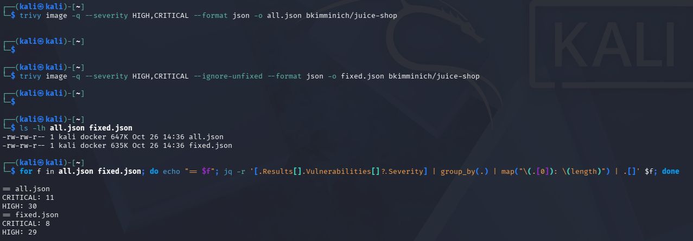

| | CRITICAL | HIGH | Total |
|---|---|---|---|
| Todo | 11 | 30 | 41 |
| Con `--ignore-unfixed` | 8 | 29 | 37 |

La diferencia son 4 hallazgos graves sin parche. Esos no se arreglan actualizando, habría que mitigarlos o cambiar el componente.

## 2. Qué paquetes hay detrás

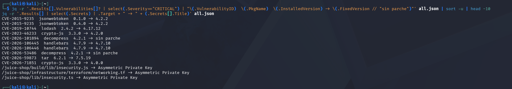

| CVE | Paquete | Instalada → Corregida |
|---|---|---|
| CVE-2015-9235 | jsonwebtoken | 0.1.0 y 0.4.0 → 4.2.2 |
| CVE-2019-10744 | lodash | 2.4.2 → 4.17.12 |
| CVE-2023-46233 | crypto-js | 3.3.0 → 4.2.0 |
| CVE-2026-71851 | crypto-js | 3.3.0 → 4.0.0 |
| CVE-2026-106445 y 106446 | handlebars | 4.7.9 → 4.7.10 |
| CVE-2026-59873 | tar | 6.2.1 → 7.5.19 |
| CVE-2026-101894 y 53486 | decompress | 4.2.1 → sin parche |

Varias dependencias son muy viejas (`jsonwebtoken` 0.1.0 y `lodash` 2.4.2 son de 2015-2019). `decompress` tiene dos críticos sin parche, y justo esos son los que `--ignore-unfixed` esconde.

## 3. Secretos en la imagen

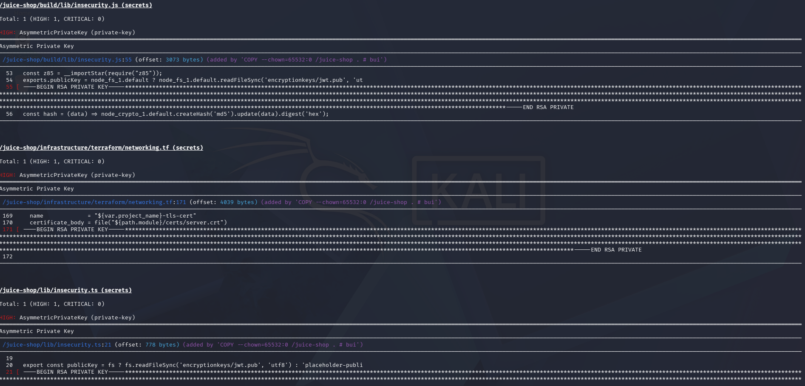

Trivy encuentra tres claves privadas RSA dentro de la imagen:

- `/juice-shop/build/lib/insecurity.js` (línea 55)
- `/juice-shop/infrastructure/terraform/networking.tf` (línea 171)
- `/juice-shop/lib/insecurity.ts` (línea 21)

En Juice Shop es normal porque es un laboratorio, pero en una imagen real sería un incidente: habría que rotar la clave, sacarla de la imagen y reconstruirla.

Para probar la detección con un fichero mío usé un `config.py` con claves inventadas:

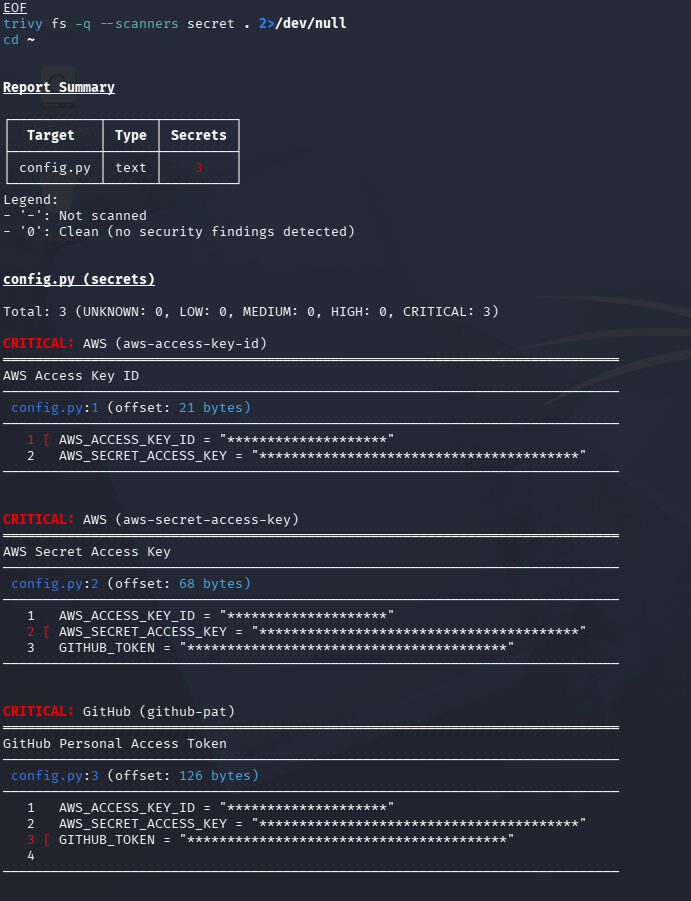

## 4. Priorizar: el caso de lodash (CVE-2019-10744)

En NVD tiene un CVSS 3.1 de 9.1 CRITICAL (vector `AV:N/AC:L/PR:N/UI:N/S:U/C:N/I:H/A:H`), es una prototype pollution en `defaultsDeep` de lodash anterior a 4.17.12.

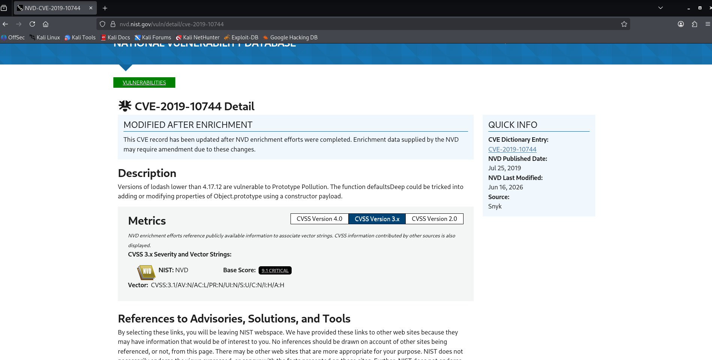

Pero el EPSS cuenta otra historia:

```bash
curl -s "https://api.first.org/data/v1/epss?cve=CVE-2019-10744" | jq
```

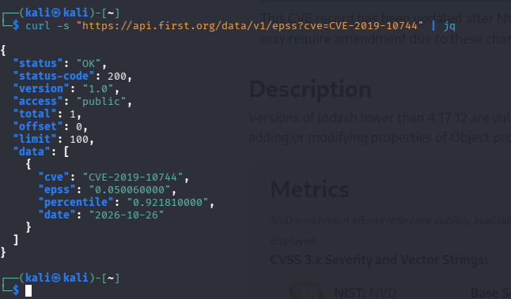

El `epss` es 0.05006, es decir, un 5 % de probabilidad de explotación en los próximos 30 días, aunque el percentil es 0.92 (está entre los más explotables).

Con eso, mi criterio sería corregirlo en el ciclo actual porque el parche es barato (subir lodash a 4.17.12 o superior), pero no parar un despliegue por él sin comprobar antes si la aplicación llama a `defaultsDeep` con datos del usuario. Sin eso, el CVE no sería alcanzable.

## 5. SBOM

```bash
trivy image -q --format cyclonedx -o juice-sbom.json bkimminich/juice-shop
trivy sbom -q --severity HIGH,CRITICAL juice-sbom.json
```

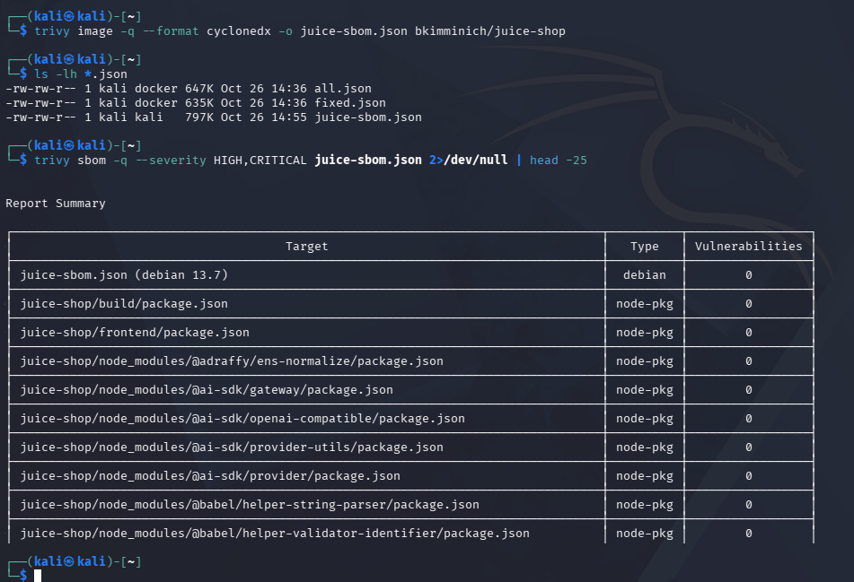
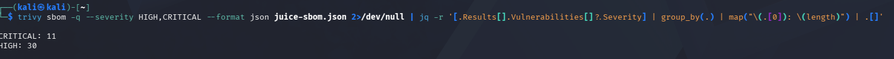
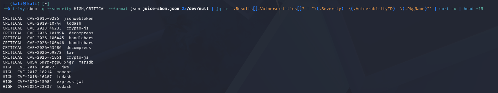

El SBOM pesa unos 800 KB (está en [examples/output](../examples/output/)) y da lo mismo que la imagen: 11 CRITICAL y 30 HIGH. Es útil para revisar lo que entrega un proveedor sin tener su imagen.

## 6. Excepciones con .trivyignore

```bash
echo "CVE-2015-9235" > .trivyignore
```

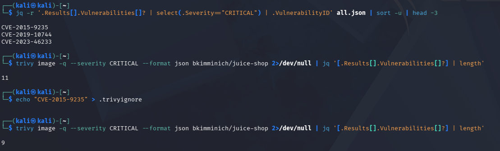

Pasé de 11 a 9 críticos, no a 10, porque ese CVE aparecía en dos instancias de `jsonwebtoken`. Por eso en [examples/.trivyignore.yaml](../examples/.trivyignore.yaml) lo acoto por ruta y le pongo motivo y fecha de caducidad.

## 7. Corregir y volver a escanear

Lo que habría que hacer es actualizar `jsonwebtoken`, `lodash`, `crypto-js`, `handlebars` y `tar` a las versiones corregidas y repetir el escaneo.

Como referencia escaneé también la imagen `node:22-alpine`:

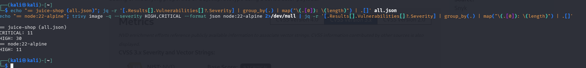

| Imagen | CRITICAL | HIGH |
|---|---|---|
| `bkimminich/juice-shop` | 11 | 30 |
| `node:22-alpine` | 0 | 11 |

Esto no es una comparación justa (una es una aplicación completa y la otra solo un runtime), pero deja ver que los críticos de Juice Shop vienen de sus dependencias, no de la imagen base. Y que ni una base limpia sale a cero.

## 8. Misconfiguraciones

Con los ficheros de [examples/iac](../examples/iac/):

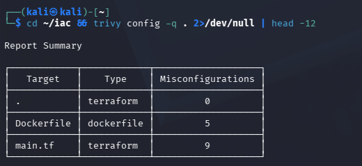
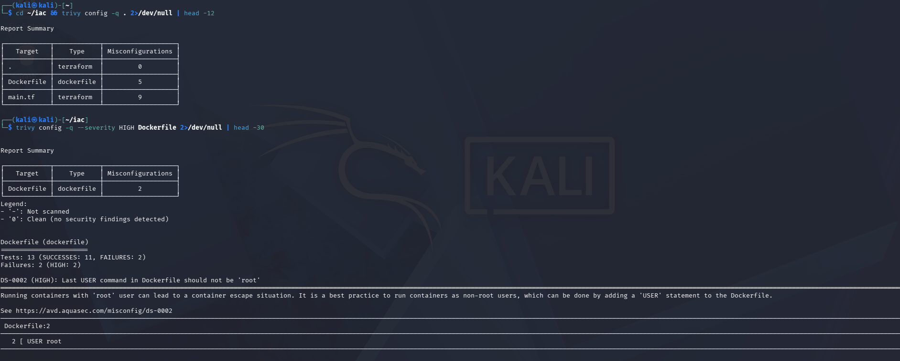

- `Dockerfile`: `USER root` (HIGH), puerto 22 expuesto, `ADD` en vez de `COPY`. Corrección: crear un usuario sin privilegios, no exponer SSH y usar `COPY`.
- `main.tf`: 9 fallos, casi todos por el bucket con `acl = "public-read"` y sin `aws_s3_bucket_public_access_block`. Al reportarlo los agruparía como un solo problema.

## 9. Un repositorio: NodeGoat

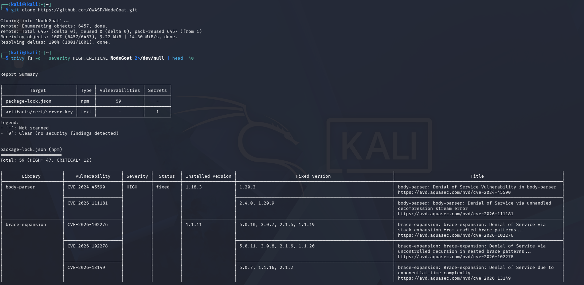

`trivy fs` sobre NodeGoat da 59 vulnerabilidades en `package-lock.json` (47 HIGH y 12 CRITICAL) y un secreto en `artifacts/cert/server.key`. Sin construir nada.

## Resumen para el informe

| Hallazgo | Prioridad | Acción |
|---|---|---|
| 3 claves privadas RSA en la imagen | Alta | Rotar, sacarlas de la imagen y reconstruir |
| 8 críticos con parche en dependencias | Alta | Actualizar las dependencias |
| 3 críticos sin parche | Media-alta | Mitigar o sustituir el componente |
| `USER root`, SSH expuesto, bucket público | Alta (el bucket) | Ver punto 8 |
