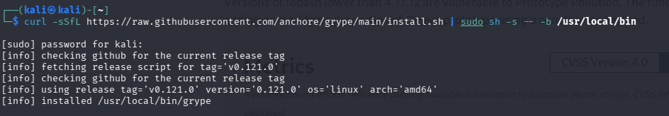
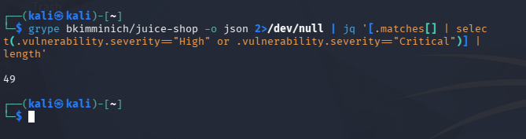

# Limitaciones y alternativas

## Lo que Trivy no hace

- Solo conoce CVE publicados. No encuentra 0-days ni fallos de lógica en nuestro código.
- Es estático: no sabe si la función vulnerable se llama de verdad. Por eso un CVSS de 9.1 como el de lodash puede no ser alcanzable ([caso práctico](04-caso-practico.md)).
- Depende de la base de datos. Un CVE mal asignado a un paquete da falsos positivos o negativos.
- Detecta lo que reconoce. Un binario copiado a mano puede no aparecer, así que un 0 no garantiza que esté limpio.
- `--ignore-unfixed` oculta riesgo real (el caso de `decompress`).
- Da la severidad del CVE, pero no el impacto en nuestro negocio ni la probabilidad de explotación (para eso EPSS).
- Los secretos se buscan por patrones conocidos. Uno con formato propio pasa desapercibido, y la clave de ejemplo de AWS está excluida a propósito.
- En IaC marca igual de importante un `ADD` mal usado (LOW) que un bucket público (HIGH), hay que filtrar por severidad.

## Alternativas

| Herramienta | Para qué | Cuándo la preferiría |
|---|---|---|
| Grype | Escaneo de imágenes y ficheros | Segunda opinión con otra base de datos |
| Nuclei | Escaneo dinámico con plantillas | Ver si un servicio expuesto es explotable |
| OWASP ZAP / Burp | Pruebas de aplicaciones web | Fallos de lógica, autenticación, XSS, SQLi |
| Semgrep / CodeQL | SAST sobre código propio | Vulnerabilidades en nuestro código |
| Dependabot / Snyk | Dependencias con corrección automática | Si se quiere una PR que actualice sola |
| Checkov / tfsec | IaC | Políticas de IaC más profundas |
| Gitleaks / TruffleHog | Secretos | Revisar el historial completo de git (Trivy mira el árbol actual) |
| OpenVAS / Nessus | Hosts y servicios en red | Infraestructura en ejecución |

## Prueba con Grype

```bash
curl -sSfL https://raw.githubusercontent.com/anchore/grype/main/install.sh | sudo sh -s -- -b /usr/local/bin
grype bkimminich/juice-shop -o json 2>/dev/null | jq '[.matches[] | select(.vulnerability.severity=="High" or .vulnerability.severity=="Critical")] | length'
```




| Escáner | HIGH + CRITICAL |
|---|---|
| Trivy 0.76.1 | 41 (11 CRITICAL y 30 HIGH) |
| Grype 0.121.0 | 49 |

No dan lo mismo. Las razones probables son que usan fuentes de datos distintas y que cuentan de forma distinta (Grype cuenta cada coincidencia, y un mismo CVE puede repetirse por paquete e instancia). No he revisado una a una las 8 diferencias, así que no sé cuáles son falsos positivos. Lo razonable sería usar los dos y revisar a mano lo que sale solo en uno.

## Cuándo no basta con Trivy

- Si hay que auditar una aplicación web en producción, hace falta además un escáner dinámico.
- Para revisar código propio, hace falta SAST.
- Para gestionar vulnerabilidades en una empresa (inventario, plazos, tickets), una plataforma que use el JSON o SARIF de Trivy.

## Conclusión

Trivy sería lo primero que lanzaría ante un contenedor, un repositorio o un SBOM: es rápido, un solo binario y cubre bastante. Pero solo responde a qué CVE conocidos hay. Decidir qué arreglar primero, qué es falso positivo y qué riesgo se acepta lo tiene que hacer el analista.
